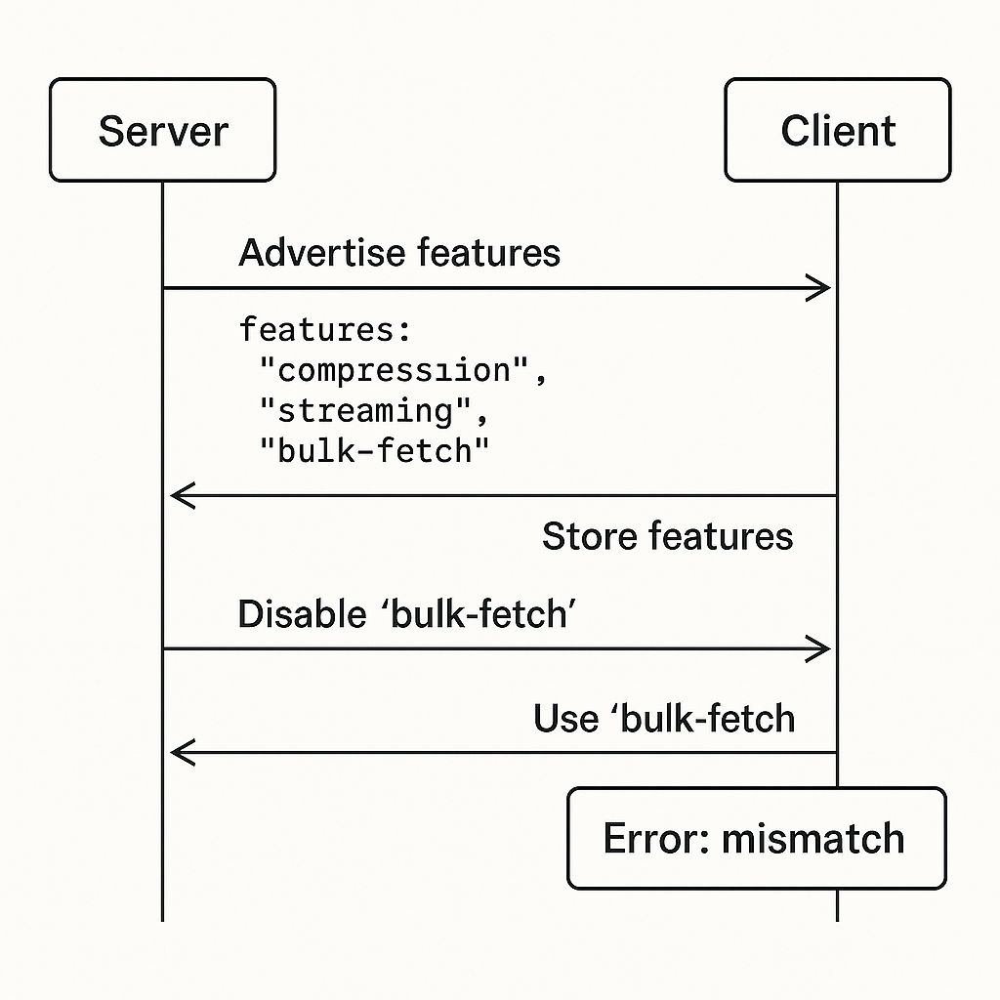

> Building platforms, APIs, and shared libraries isn't just about clean code.
> It's about not breaking people.

The stories in this post come from an in-house, in-memory database system,
optimized for post-trade data and workflows: risk, PnL, trade capture, and
feeds to back-office systems. It's used across businesses (FX, rates,
commodities, etc.), and the scale is large: about 10,000 database instances,
and a number of applications using it in the order of tens of thousands.

When you build platforms, APIs, or shared libraries, your users aren't just
"other teams". They're often hundreds of services, workflows, or people you've
never met. Every small change can have a big, invisible blast radius.

I used to think breaking changes meant changing an endpoint or removing a
field. But over time, I learned that backward compatibility goes much deeper
than that. It includes performance, side channels, debug output, even the
order of keys in a JSON string.

This post is about the things we broke without meaning to, what we learned the
hard way, and how to design systems that evolve without surprising your users.

## The usual advice still matters

When people talk about backward compatibility, the usual advice sounds simple:

* Use versioning.
* Make only additive changes.
* Introduce new behaviors as opt-in.
* Be tolerant when reading inputs, strict when writing outputs.

This advice covers the basics, but it doesn't protect you from the real-world
surprises below.

## Clients parsing error messages

We had an API that returned clear error codes and messages like:

> Error: not allowed to see object "xxx"

We thought clients would use the code to decide what to do. Instead, some
teams started parsing the error string itself, pulling out the object name.

One day, we changed the wording slightly to improve clarity. It broke their
applications.

## Debug endpoints meant for humans

We exposed an HTTP endpoint to show debug information. It was meant to be read
by humans, in a browser. We even documented it clearly:

> This endpoint is for human viewing only. Output format is not stable for
> automation.

Still, some teams built scripts that depended on the exact debug output. When
we reformatted it for readability, their scripts failed.

Even when you say "do not depend on this", someone eventually will.

## Internal systems aren't always internal

We had internal message queues, used to pass messages between our own
services. They were undocumented, private, and never intended for external
use.

But someone found them. They built a prototype that read our internal
messages, and that prototype grew into a production system.

When we changed the message format, their app broke. Technically, it
was their fault. But in production, it became everyone's problem.

## Performance is part of the contract

Backward compatibility isn't just about what your system does. It's also about
how fast it does it.

We once made a small change to a low-level data retrieval API. The
functionality stayed the same, but the API got slightly slower.

That tiny performance degradation triggered cascading timeouts, retries, and
failures across client applications. Partial failures are incredibly hard to
debug, and a slowdown can cause just as much damage as an outright break.

## When safe changes break unsafe clients

JSON doesn't guarantee key order. Still, when we refactored an API and
reordered the keys in our JSON output, one team broke.

They had written a fragile parser that extracted a string based on fixed
character positions in the JSON text. When the order changed, so did the
character offsets, and their application failed.

This raised a hard question: what level of backward compatibility should we
guarantee?

In this case, it was the client's fault for depending on unstable behavior.
We shouldn't avoid safe improvements like this, but it shows how creative
clients can be in unexpected ways.

## Feature flags and runtime toggles

One way to ship changes safely is to use feature flags, or toggles. They let
us introduce new behavior gradually and selectively. But toggles come with
hidden dangers, especially when your system advertises capabilities to
clients.

Imagine a system where the server sends this when a client connects:

```json
{
  "features": ["compression", "streaming", "bulk-fetch"]
}
```

The client reads this once during the handshake, and configures itself based
on the available features.

Now imagine that at runtime, an operator disables `bulk-fetch` through a
feature flag. The server stops accepting bulk-fetch operations immediately.
But the client still thinks the feature is available, because it cached the
server's original response.

This mismatch leads to hard-to-diagnose bugs: the server thinks bulk-fetch is
disabled, and the client keeps trying to use it.



If features can be toggled dynamically, you need a way to re-negotiate
capabilities at runtime, or ensure that changes don't break existing
conversations.

## Hidden traps

### "Public" means reachable, not documented

Anything visible can and will become a dependency. If someone can see it,
someone will eventually use it, no matter what you write in the documentation.

### Warning signs of accidental dependencies

* Easy to scrape: people love easy shortcuts.
* No better alternative: if it's the only way, they'll take it.
* Faster or simpler than the official APIs: teams under time pressure will use
  whatever works.

### How to harden internal things

If you don't want others to depend on something:

* Require authentication or special access.
* Add headers or tags clearly marking the response as internal-only.
* Serve internal-only endpoints from separate domains or separate ports.

The harder it is to depend on something accidentally, the safer you are.

## When breaking changes are necessary

Sometimes breaking changes are unavoidable, for example for security
vulnerabilities, major architectural changes, or cleaning up technical debt.

When you must break something:

* Communicate early, often, and clearly.
* Offer dual-stack: old and new versions running side-by-side for a while.
* Add deprecation warnings in responses, headers, or logs to alert users.

The goal is never "no breakage". The goal is "no surprises".

## Building a culture of compatibility

Backward compatibility isn't just a checklist, it's a mindset:

* Think about how people might depend on you, even in ways you didn't intend.
* Design systems assuming that every visible thing might eventually become a
  contract.
* Celebrate engineers who raise compatibility concerns during design reviews.

Backward compatibility is about empathy. It's about remembering that someone
else, somewhere, is relying on you.

We don't just build software for ourselves. We build it for everyone who will
depend on it, today, tomorrow, and years from now. The best platforms aren't
just powerful, they're trustworthy.
